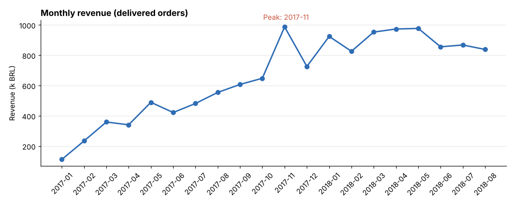
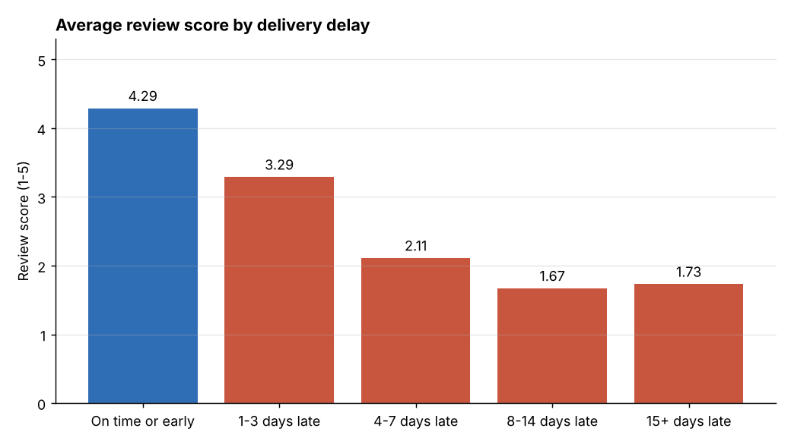
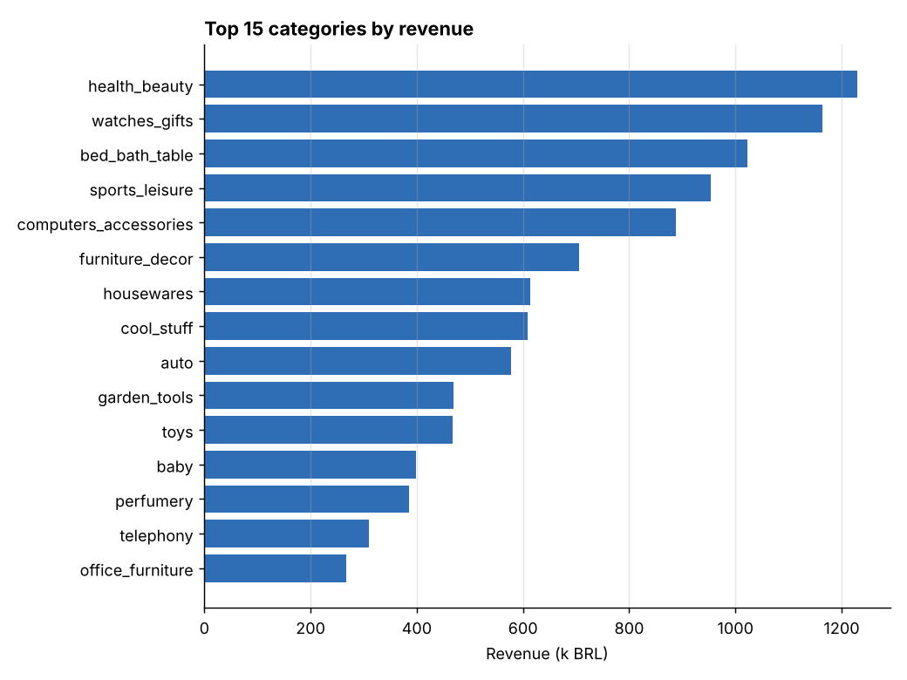
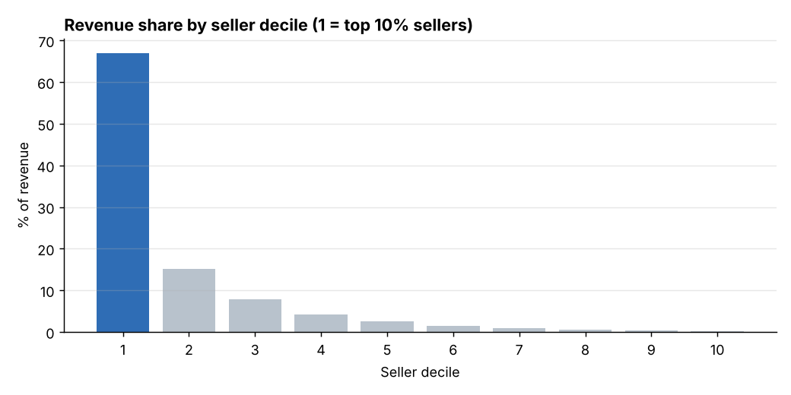
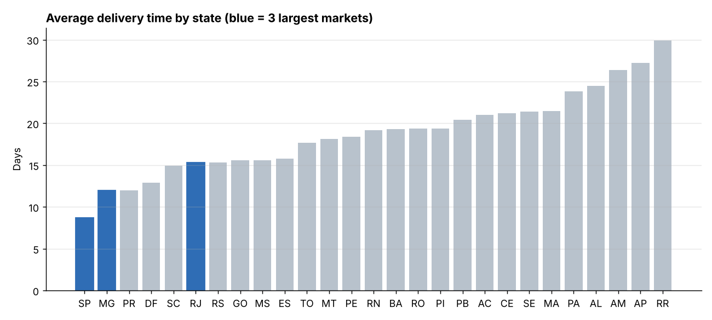

# 🛒 E-commerce Sales Analysis - SQL, Python & Power BI


Analysis of **100,000 real orders** from Olist, the largest marketplace in Brazil, to answer business
questions about sales, products, delivery and customer satisfaction.

The project follows the work of a data analyst: raw relational data → **data quality checks** →
**SQL analyses** → charts and findings → **star schema for a Power BI dashboard** →
business recommendations.

---

## 🎯 Business questions

1. How are sales evolving, and is there seasonality?
2. Which product categories and sellers drive revenue?
3. Does late delivery hurt customer satisfaction?
4. Are there regional differences in delivery time and shipping cost?
5. Do customers come back?

**Data**: [Olist Brazilian e-commerce dataset](https://github.com/olist/work-at-olist-data)
(MIT licence) - 8 tables: orders, items, payments, reviews, customers, products, sellers,
category translation. Period analysed: **January 2017 → August 2018** (complete months),
delivered orders only.


## 📊 Key results

| KPI | Value |
|---|---|
| Delivered orders | 96,211 |
| Customers | 93,104 |
| Revenue (products, freight excluded) | 13.2 M BRL |
| Average basket | 137 BRL |
| Average delivery time | 12.5 days |
| Orders delivered late | 6.8% |
| Average review score | 4.16 / 5 |

### 1. Strong growth, with a Black Friday peak

<p align="center"></p>

- Monthly revenue is **+263%** higher in summer 2018 than in Q1 2017.
- Best month: **November 2017** (Black Friday) with 988 k BRL. In the same month, the share of
  late deliveries rose from about 4% to **12.4%**: logistics did not follow the peak.
- Growth has slowed since spring 2018 (between 830 and 980 k BRL per month).

### 2. Late delivery destroys satisfaction

<p align="center"></p>

| Delivery | Orders | Avg review | 1-2 star reviews |
|---|---|---|---|
| On time or early | 89,182 | **4.29** | 9.2% |
| 1-3 days late | 1,851 | 3.29 | 32.2% |
| 4-7 days late | 1,748 | 2.11 | 67.6% |
| 8-14 days late | 1,446 | 1.67 | 80.1% |
| 15+ days late | 1,333 | **1.73** | 78.2% |

Only one or a few days of delay are enough to lose a full point of satisfaction. Delay is the
clearest driver of bad reviews in the dataset.

### 3. Revenue is concentrated

<p align="center">
  
  
</p>

- **8 categories out of 74** make half of the revenue (health & beauty, watches & gifts,
  bed & bath, sports, computers, furniture, housewares, "cool stuff").
- The **top 10% of sellers make 67% of revenue**.

### 4. Big regional gaps

<p align="center"></p>

- São Paulo, Rio de Janeiro and Minas Gerais make **63% of revenue**.
- Average delivery takes **8.7 days in São Paulo** but **20 to 30 days in the North**
  (e.g. 29.9 days in Roraima), where freight also costs more (up to 28% of the product price
  versus 14% in São Paulo).
- Rio de Janeiro has a high late-delivery rate (12.1%) despite being a large market.

### 5. Almost no repeat customers

- **97% of customers ordered only once** in 20 months; repeat customers bring only 5.5% of revenue.
- 77% of orders are paid by credit card (3.5 instalments on average), 20% by *boleto*.

## 💡 Recommendations

1. **Protect the delivery promise**: add a safety margin to estimated delivery dates in slow
   states and during peaks (Black Friday), since being late costs much more than announcing a
   longer delay.
2. **Prepare logistics before peaks**: plan carrier capacity for November using the 2017 peak.
3. **Work on loyalty**: with 97% one-time buyers, a post-purchase campaign (voucher for a second
   order, especially after an on-time delivery) is a large opportunity.
4. **Key account management for top sellers**: the top 10% sellers carry two thirds of revenue;
   monitoring their delivery performance and stock is a priority.
5. **Regional freight policy**: study freight subsidies or local sellers in the North and
   North-East, where freight and delays reduce competitiveness.

## 🧹 Data quality

Before any analysis, 12 automatic checks are run on the raw tables
([full report](reports/data_quality.md)):

| Check | Result |
|---|---|
| Duplicate orders, orphan items or customers, negative prices | ✅ none |
| Orders without items | ⚠️ 775 (0.8%) - excluded from sales KPIs |
| Delivered orders without delivery date | ⚠️ 8 - excluded from delivery metrics |
| Orders with several reviews | ⚠️ 547 - average score used |
| Products without category | ⚠️ 610 (1.9%) - grouped as `unknown` |
| Categories without English translation | ⚠️ 2 - Portuguese name kept |

## 🧱 Project structure

```
olist_ecommerce_analysis/
├── sql/
│   ├── 00_views.sql              # analysis views (one row per order / per item)
│   └── analysis/                 # one SQL file per business question
│       ├── 01_kpis.sql
│       ├── 02_monthly_sales.sql
│       ├── 03_categories.sql     # Pareto with window functions
│       ├── 04_delivery_vs_reviews.sql
│       ├── 05_states.sql
│       ├── 06_repeat_customers.sql
│       ├── 07_sellers.sql        # NTILE deciles
│       └── 08_payments.sql
├── src/olist_analysis/
│   ├── load.py                   # CSV -> SQLite database + indexes + views
│   ├── quality.py                # data quality checks and report
│   ├── analysis.py               # runs SQL files, charts, findings
│   ├── export_powerbi.py         # star schema for Power BI
│   └── pipeline.py               # runs everything
├── powerbi/                      # Power BI guide (data model, DAX measures, pages)
├── reports/                      # results: tables, figures, insights, data quality
├── scripts/download_data.py
├── tests/                        # pytest on a small synthetic dataset
└── .github/workflows/ci.yml      # lint + tests + full analysis on real data
```

SQL techniques used: joins across 8 tables, views, CTEs, aggregations, `CASE` buckets,
window functions (`SUM() OVER`, running totals, `NTILE`), date functions.

## 🚀 Quick start

```bash
git clone https://github.com/yousseftafoughalti1818-svg/olist_ecommerce_analysis.git
cd olist_ecommerce_analysis
python -m venv .venv
.venv\Scripts\activate            # Windows  (Linux/Mac: source .venv/bin/activate)
pip install -r requirements-dev.txt
pip install -e .

python scripts/download_data.py   # downloads the 8 CSV files (~110 MB)
python -m olist_analysis.pipeline # database, quality report, analyses, charts, Power BI files
pytest -q                         # tests
```

Outputs:
- `reports/insights.md` - key findings
- `reports/data_quality.md` - data quality report
- `reports/tables/*.csv` - result of each SQL query
- `reports/figures/*.png` - charts
- `powerbi/data/*.csv` - star schema to load in Power BI

## 📈 Power BI dashboard

The pipeline exports a star schema (2 fact tables, 4 dimensions). The data model, relationships,
DAX measures (revenue, average basket, month-over-month growth, late delivery rate…) and the
3 report pages are described in [`powerbi/README.md`](powerbi/README.md).

## 🛠️ Tech stack

SQL (SQLite) · Python · pandas · Matplotlib · Power BI · DAX · pytest · GitHub Actions

## ⚠️ Limits

- The dataset is a sample published by Olist, so absolute numbers are lower than the real
  company figures; trends and ratios are what matter here.
- Late delivery is measured against the date promised to the customer, by month of purchase.
- The link between delay and reviews is a correlation; other factors (product quality, seller)
  also play a role.

## 👤 Author

**Youssef Tafoughalti** - M2 Complex Systems Engineering (EILCO)
[LinkedIn](https://www.linkedin.com/in/youssef-tafoughalti-b1012a196/) ·
[GitHub](https://github.com/yousseftafoughalti1818-svg)
